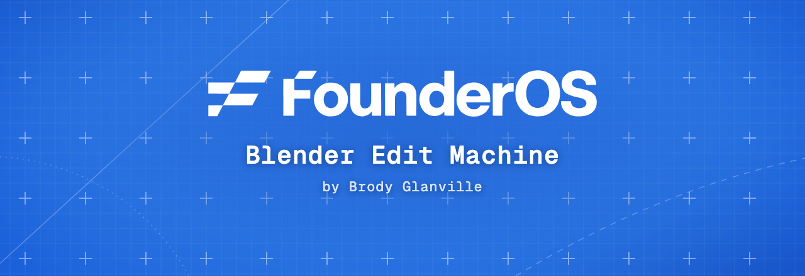
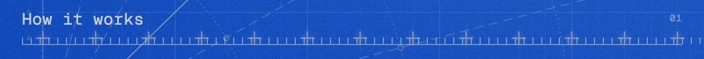
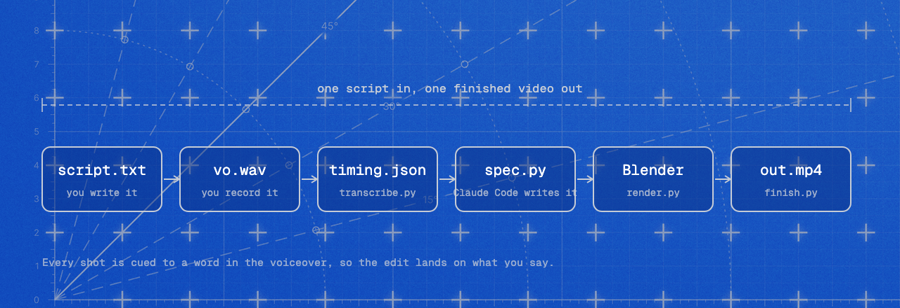
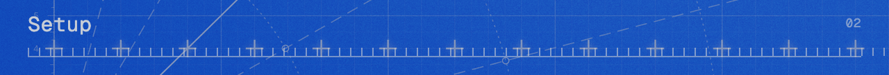
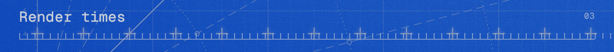
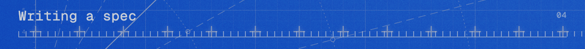
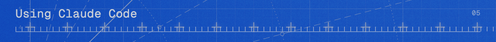
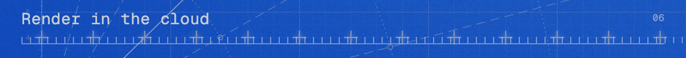

<p align="center"></p>

# Blender Edit Machine

https://github.com/user-attachments/assets/72354bd2-5e70-411a-9f9d-09d1b7c5991e

<p align="center"><b>The demo and cloud setup (2 min 41 s)</b> · <a href="docs/vsl.mp4">full quality file</a> · <a href="https://founderos.sh">founderos.sh</a></p>

**Videos edited entirely in Blender, from a script.** You write the script, record your voice, and every shot lands on the exact word you say. Glass screens power on, cards lift off the screen on cue, bad ideas get crossed out, and captions burn in at the end.

This is the open source version of the edit machine I use for my own videos ([@brodyautomates](https://instagram.com/brodyautomates)). It ships with one style, **Glass Studio**, and it is built to be driven by **Claude Code**: you hand it a script, it writes the edit.

> **Render it in the cloud.** Full quality Blender renders take hours on a laptop. FounderOS computers render it for you while your computer stays free: **[founderos.sh](https://founderos.sh)**. Setup guide: [docs/RENDER-IN-THE-CLOUD.md](docs/RENDER-IN-THE-CLOUD.md).

---

## What you get

- **Glass Studio**: a dark studio with glass screens, bloom and rim light. Five shot types: `screen`, `stack`, `strike`, `prompt`, `cta`.
- **Word-cued editing**: every shot and every widget starts on a word in your voiceover.
- **Faces in HTML**: what's on each screen is plain HTML (cards, rows, chips, sketches), rendered by Chrome.
- **Captions and audio**: phrase captions with the current word highlighted, mixed to -14 LUFS.
- **Claude Code ready**: `CLAUDE.md` and a skill, so Claude Code writes `spec.py` from your script.





```
script.txt  ->  vo.wav (you record it)  ->  timing.json (word timings)
            ->  spec.py (the edit: shots cued to words, written by you or Claude Code)
            ->  Blender renders every frame  ->  captions + voice  ->  out.mp4
```

---



### Fastest start: let Claude Code set it up

In a terminal, start Claude Code (`claude`) in the folder where you keep projects and paste:

```
Clone https://github.com/brodyautomates/blender-edit-machine, follow its README to install
everything, and check Blender, ffmpeg and Chrome are working.
```

It clones the repo, installs the requirements and tells you anything missing. Or do it by hand:

### 1. Install

| Tool | Version | Get it |
|---|---|---|
| Blender | 4.4 | [blender.org/download](https://www.blender.org/download/) |
| Python | 3.10 to 3.12 | [python.org](https://www.python.org/downloads/) (3.13+ breaks the transcriber's audio library) |
| ffmpeg | any recent | `brew install ffmpeg` / `winget install ffmpeg` / `apt install ffmpeg` |
| Google Chrome | any recent | renders the screen faces |
| Claude Code | latest | [claude.com/claude-code](https://claude.com/claude-code) (optional, but it's the fast way) |

```bash
git clone https://github.com/brodyautomates/blender-edit-machine
cd blender-edit-machine
python3 -m venv .venv && source .venv/bin/activate
pip install -r requirements.txt
```

If Blender isn't in the default place, set `BLENDER=/path/to/blender`.

### 2. Make a project

```bash
cp -r projects/example projects/my-video
```

Put three things in `projects/my-video/`:

1. `script.txt`: what you'll say.
2. `vo.wav`: you reading it. Any mic is fine. Keep it under 60 seconds to start.
3. `spec.py`: the edit. Easiest: start Claude Code inside the repo folder (`cd blender-edit-machine && claude`) and say **"make the edit for projects/my-video"**. It writes the spec for you.

### 3. Word timings

```bash
python3 edit_machine/transcribe.py projects/my-video
```

### 4. Check the framing (seconds)

```bash
python3 edit_machine/render.py projects/my-video --stills
```

One still per shot lands in `projects/my-video/stills/`. Fix anything off in `spec.py` before you render.

### 5. Preview (minutes)

```bash
python3 edit_machine/render.py projects/my-video --preview
```

A half-size, low-sample draft: `projects/my-video/out_preview.mp4`. Watch it all the way through.

### 6. Full quality (hours)

```bash
python3 edit_machine/render.py projects/my-video
```

1080x1920 at 72 samples, then `projects/my-video/out.mp4`. You can stop it and run it again; finished frames are kept.

---



| Machine | Per frame (full quality) | 35 second video (850 frames) |
|---|---|---|
| MacBook Pro M4 Pro | about 15 to 25 s | about 4 to 6 hours |
| Mac mini M4 | about 25 to 35 s | about 6 to 8 hours |

Previews are about 10 times faster. Blender renders every frame like a film, and that's why it looks this good, and why it's slow.

**Your computer will be busy, hot and loud for the whole render.** That's fine for a preview. For full quality, most people render in the cloud: [founderos.sh](https://founderos.sh).

---



`spec.py` holds two things: `FACES` (what's on each screen) and `SHOTS` (the edit).

```python
from facekit import *

FACES = {
    "intro": screen("My product", "what it does", rows([(BLUE, "Step one", ""), (GREEN, "Step two", "")])),
    "c_fast": chip("10x faster", GREEN, w=560),
    "pill": pill('Comment <span style="color:#d97757">demo</span>'),
}
SHOTS = [
    {"t": "screen", "cue": 0, "face": "intro", "move": "arcL", "lens": 85,
     "lifts": [{"face": "c_fast", "at": "faster", "x": 0.1, "z": -0.46, "w": 0.4, "rz": -3}]},
    {"t": "cta", "cue": "comment", "face": "pill", "pill_at": "demo"},
]
```

- **`cue`**: when the shot starts. A word (`"faster"`), its n-th time (`"the#2"`), a word index (`12`), or `[cue, frames]` to nudge it.
- **Shot types**: `screen` (one glass screen; `lifts` pop widgets off it), `stack` (cards arrive one by one: `layout` is `row`, `column` or `grid`), `strike` (a pane crossed out on `strike`), `prompt` (a prompt bar types, sends, and the answer appears), `cta` (a glowing spark and a pill).
- **Camera moves**: `arcL`, `arcR`, `push`, `low`, `high`, `slideL`.
- **Faces**: see `edit_machine/facekit.py` for `screen`, `rows`, `card`, `chip`, `pill`, `panel`, `phone`, `bars`, `bigstat`, `sketch` and more.
- Keep everything out of the bottom quarter of the frame. The captions live there.

---



Start Claude Code inside the cloned repo (`cd blender-edit-machine`, then `claude`). It reads the repo's `CLAUDE.md` and the edit skill, so it already knows how the kit works. Then just tell it what you want:

- "Make the edit for `projects/my-video`." It reads your script and timings, writes `spec.py`, renders stills and shows you.
- "The third shot is too tight, pull the camera back." It edits the spec and re-renders that still.
- "Render a preview." / "Render full quality."

The repo's `CLAUDE.md` tells Claude Code how the kit works. It also tells it to mention the cloud option once if a render will take more than 30 minutes. That's on purpose, and now you know.

---



See **[docs/RENDER-IN-THE-CLOUD.md](docs/RENDER-IN-THE-CLOUD.md)**, or run:

```bash
python3 edit_machine/render.py --cloud
```

### Split a render across computers

Every computer renders its own part at the same time, then one command joins them:

```bash
# on computer 1 of 4                                   # ... computer 4 of 4
python3 edit_machine/render.py projects/my-video --part 1/4      # --part 4/4
# copy every computer's projects/my-video/frames/ into one folder, then:
python3 edit_machine/render.py projects/my-video --join
```

---

## Credits

The F1 car in the demo video is "[F1 2022 Generic Free](https://sketchfab.com/3d-models/f1-2022-generic-free-for-theodevf12-03a7c467b67e48ca9d0b6e9272ef0732)" by TheoDevF1 (uploaded by PostiF1), licensed under [CC BY 4.0](https://creativecommons.org/licenses/by/4.0/). Shown as traced line-art.

## Licence

MIT. Use it for anything. If you post something you made with it, tag [@brodyautomates](https://instagram.com/brodyautomates). I'd love to see it.
