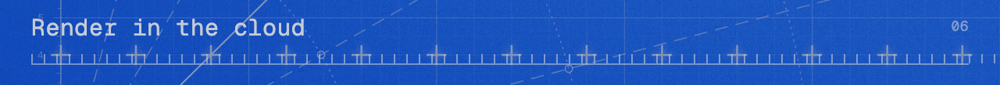
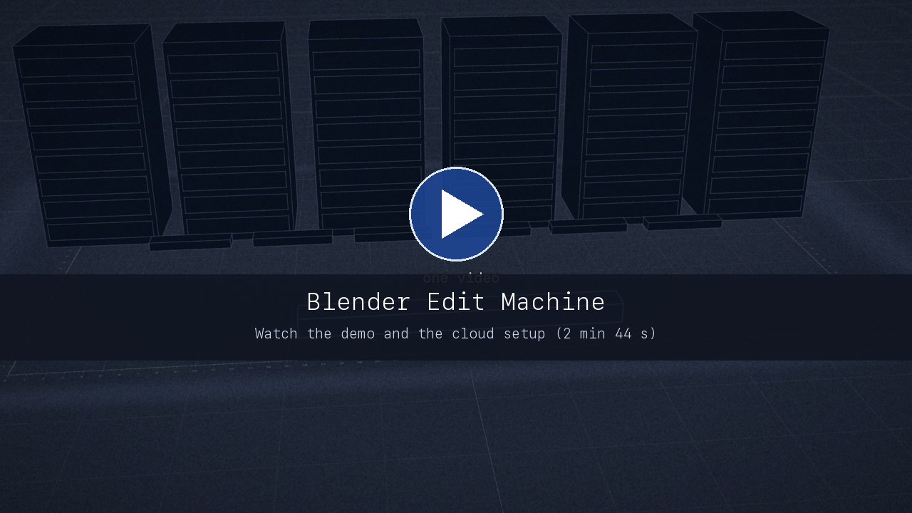

# Render in the cloud on FounderOS computers

> **[Watch the demo and setup video](vsl.mp4)** (2 min 44 s). The step by step screen recordings are being added.

A full quality render keeps your computer busy for hours. FounderOS computers run it for you in the cloud, so you can keep working, close the laptop or go to sleep.

## Why the cloud

- **Your computer stays free.** No fans, no heat, no waiting.
- **Run it in parallel.** The edit splits into chunks across many computers at once, so a render that takes hours on one machine finishes much sooner.
- **It works from any computer.** An old laptop or a Chromebook is enough to start a render.

## Setup

1. **Sign up** at [founderos.sh](https://founderos.sh).
2. **Open a computer.** *(Steps and screenshots go here once the FounderOS computer flow is final.)*
3. **Get the repo onto it:** `git clone https://github.com/brodyautomates/blender-edit-machine`
4. **Upload your project folder** (`script.txt`, `vo.wav`, `timing.json`, `spec.py`).
5. **Render:** `python3 edit_machine/render.py projects/my-video`. To go faster, open several computers and give each a part: `--part 1/4`, `--part 2/4` and so on, then copy the frames together and run `--join`.
6. **Download** `projects/my-video/out.mp4`.

*(This guide is a placeholder until the FounderOS compute flow and the demo video are published.)*
